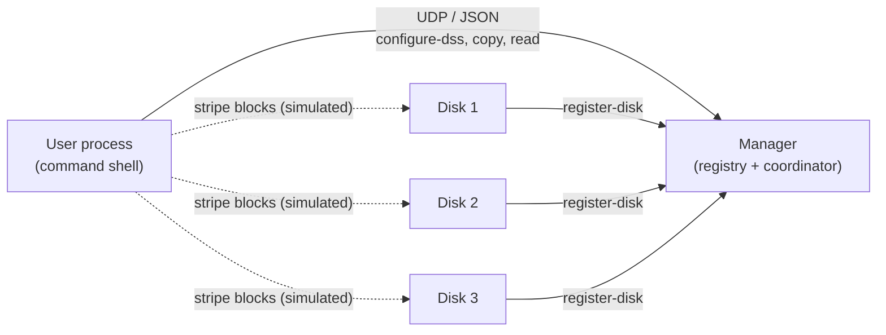
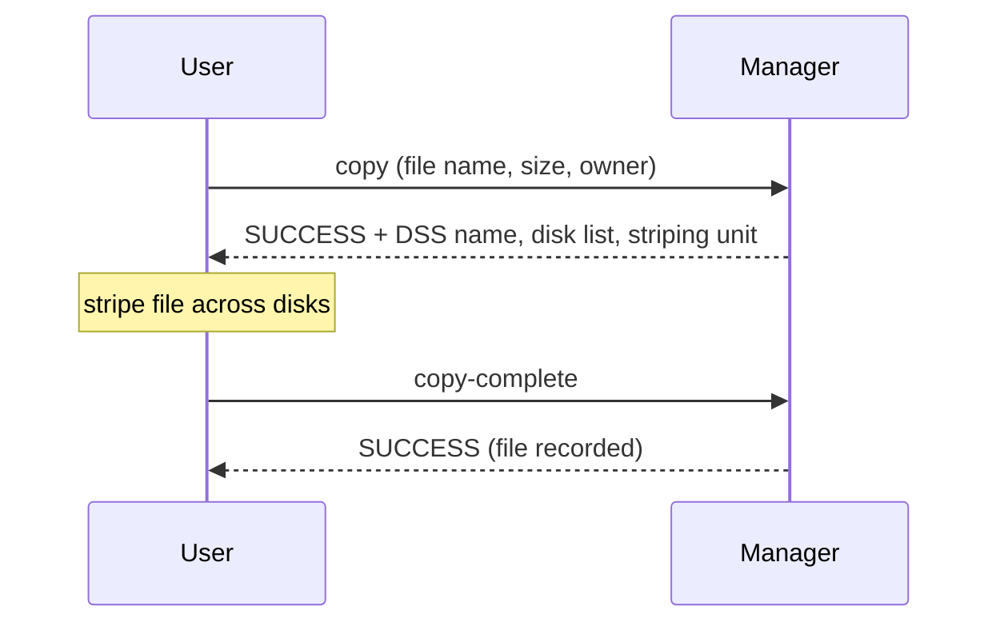

# DSS: A Distributed Storage System over UDP

A small distributed storage system built from scratch with Python sockets. A **manager** keeps track of **disks** and **users**, and files are striped across disks with **RAID-5-style rotating parity**. It was written for a Computer Networks course to show how real storage and networking systems coordinate over an unreliable network.

- Three cooperating processes (manager, disk, user), each with its own UDP socket
- A JSON request/response protocol with message IDs and timeouts
- Registration, validation, and shared state guarded by a lock
- RAID-5-style striping and a disk-failure and recovery workflow
- Standard library only, with no dependencies

> **Scope:** the networking, protocol, validation and coordination run over real UDP sockets. The data path (writing stripe blocks to disks, computing parity, rebuilding a failed disk) is **simulated**: the user process lays out stripes and logs which disk receives data or parity, but block contents are not sent to the disks. See [Limitations](#limitations).

## Quick start

Requires Python 3.8+ and nothing else.

```bash
python scripts/demo.py
```

This starts a manager and three disks on localhost, then opens an interactive prompt as user `alice`:

```text
alice> configure-dss dss1 3 128
alice> copy in-flanders.txt 0 alice
alice> ls
alice> disk-failure dss1
```

Run the tests:

```bash
python -m unittest discover -s tests -v
```

### Running each process yourself

Use one terminal per process (they can run on different machines if you replace `127.0.0.1`).

```bash
python run.py manager 1500
python run.py disk disk1 127.0.0.1 1500 1601 1602
python run.py disk disk2 127.0.0.1 1500 1603 1604
python run.py disk disk3 127.0.0.1 1500 1605 1606
python run.py user alice 127.0.0.1 1500 1701 1702
```

Arguments: `disk <name> <manager_ip> <manager_port> <m_port> <c_port>`, and likewise for `user`. Names are alphanumeric, at most 15 characters. Every `m_port` and `c_port` must be unique and in the range 1500 to 1999.

## Architecture



| Process | File | Role |
| --- | --- | --- |
| Manager | [`src/manager.py`](src/manager.py) | Registers users and disks, validates parameters, builds DSS (storage group) configurations, and tracks in-flight copy, read and failure operations |
| Disk | [`src/disk.py`](src/disk.py) | Registers with the manager, then listens on its command port and handles `fail` |
| User | [`src/user.py`](src/user.py) | Interactive shell that asks the manager for a plan, stripes the file, and reports completion |

The manager dispatches each message by command name (`copy` goes to `_handle_copy`, `register-disk` to `_handle_register_disk`) while holding a lock, so concurrent messages cannot corrupt the shared registry.

### Two-phase operations

Copy, read and disk-failure are each split into two messages so the manager can reject conflicting work (for example, a second copy while one is in progress):



## Protocol

Every message is one JSON object in one UDP datagram.

```json
{
  "command": "configure-dss",
  "params": {"dss_name": "dss1", "n": 3, "striping_unit": 128},
  "timestamp": "2026-10-14T10:41:49.102934",
  "message_id": "msg_20261014104149102934"
}
```

Replies carry `status` (`SUCCESS` or `FAILURE`), a human-readable `message`, an optional `data` object, and a timestamp.

| Command | Sender | Purpose |
| --- | --- | --- |
| `register-user`, `register-disk` | user, disk | Join the system with a name, IP, and two ports |
| `deregister-user`, `deregister-disk` | user, disk | Leave; a deregistered disk is removed from its DSS, and a DSS left with fewer than 3 disks is dissolved |
| `configure-dss` | user | Create a DSS from `n` free disks with a striping unit |
| `ls` | user | List DSS configurations and stored files |
| `copy`, `copy-complete` | user | Two-phase file store |
| `read`, `read-complete` | user | Two-phase file read |
| `disk-failure`, `recovery-complete` | user | Two-phase failure and recovery |

### Validation rules enforced by the manager

- Names are alphanumeric and 15 characters or fewer
- Ports are integers in 1500 to 1999, unused, and the two ports of a process differ
- A DSS needs at least 3 disks and enough free disks
- The striping unit is a power of two between 128 B and 1 MB
- Duplicate files and overlapping conflicting operations are rejected

## RAID-5-style striping

For a DSS of `n` disks, each stripe holds `n - 1` data blocks and one parity block. The parity block rotates across the disks from the last disk backward, so no single disk becomes the parity bottleneck. With 3 disks and a 128 B unit, a 587-byte file needs 3 stripes:

| Stripe | disk1 | disk2 | disk3 |
| --- | --- | --- | --- |
| 1 | data | data | **parity** |
| 2 | data | **parity** | data |
| 3 | **parity** | data | data |

Usable capacity is `(n - 1) / n` of the raw capacity, and any single disk can be lost without losing data.

## Technologies used

- **Python 3** (standard library only)
- **`socket`**: UDP datagram sockets (`AF_INET`, `SOCK_DGRAM`)
- **`json`**: message encoding
- **`threading`**: lock around shared manager state
- **`logging`**: per-process logs
- **`datetime`**: timestamps and message IDs
- **`subprocess`**: launching processes in the demo
- **`unittest`**: loopback integration tests
- **Git and GitHub**: version control and hosting
- **Mermaid**: architecture and sequence diagrams in this README

## How the technologies were used

**Sockets (UDP).** Each process opens its own `SOCK_DGRAM` socket. The manager binds to a well-known port and receives from any sender with `recvfrom`, which also returns the sender's address, so it can reply to whoever asked. Disks and users bind to their own command ports after registering. Sockets use a timeout (5 seconds by default), so a lost datagram produces a timeout and an error message instead of a hang.

**JSON.** Each message is one JSON object in one datagram, with `command`, `params`, `timestamp` and `message_id`. Because UDP preserves message boundaries, there is no framing code. The manager turns the command name into a handler name (`register-disk` becomes `_handle_register_disk`) and looks it up with `getattr`, so adding a command means adding one method. A message that is not valid JSON is logged and ignored.

**Threading.** The manager holds a `threading.Lock` while a handler runs, so two messages cannot update the registry, the DSS list, or the in-flight copy, read and failure operations at the same time. That keeps checks like "is a copy already in progress?" consistent.

**Logging.** Every process logs through `logging` with a process name and timestamp, so interleaved output from the manager, disks and a user reads as a single trace of the protocol. Message-building details go to `DEBUG` level so they stay out of normal output.

**Datetime.** Timestamps stamp each message and reply, and message IDs are built from the current time, giving each message a unique identifier for tracing in the logs.

**Subprocess.** `scripts/demo.py` starts the manager and three disks as separate OS processes, then runs the user shell in the foreground. This shows the system running as independent processes that talk only over sockets, the way they would on separate machines.

**Unittest.** The tests start a real manager on a loopback port in a background thread and send it raw UDP messages. They check name and port validation, duplicate-port rejection, DSS creation rules, and the `ls` command, which exercises the protocol without needing a user terminal.

**Git, GitHub and Mermaid.** The project history is in Git on GitHub. The diagrams are Mermaid code blocks, which GitHub renders directly from the README.

## How this relates to real systems

| In this project | In real systems |
| --- | --- |
| UDP datagrams carrying small request/response messages, with timeouts | DNS, SNMP, syslog, and DHCP all use UDP for short exchanges and handle loss at the application layer |
| Manager as a central registry and coordinator | The metadata or control plane in HDFS (NameNode), Ceph (monitors), and SDN controllers |
| Nodes register with a known address and port | Service registration and discovery (Consul, etcd), and switches or agents joining a controller |
| Fixed port range, unique ports per process | Port allocation and firewall rules for services on a host |
| Two-phase `copy` then `copy-complete` | Reserve-then-commit steps in storage and transaction protocols |
| Striping unit and rotating parity | RAID 5 in hardware controllers and `mdadm`, and stripe layouts in parallel file systems |
| Lock around shared manager state | Serializing updates to a control-plane database |
| Failure message and recovery workflow | Degraded-mode operation and rebuild in RAID arrays and data centers |

## Limitations

This is a teaching project, and it is honest about what it does not do:

- **Simulated data path:** the user logs stripe placement and parity layout, but `_calculate_parity` is a placeholder and block contents are never sent to disks. A disk's `storage` map stays empty.
- **Simulated recovery:** `disk-failure` picks a random disk and logs the rebuild steps. It does not currently send `fail` to the disk process, although the disk implements that handler.
- **No reliability layer:** UDP replies are not retransmitted if lost, and the manager keeps all state in memory only.
- **No authentication or encryption.**
- **Single manager:** there is no replication or failover.

Natural next steps: send real blocks to disks, compute XOR parity, and rebuild from surviving disks.

## Project layout

```text
run.py              entry point: python run.py <manager|disk|user> ...
config/constants.py shared constants (ports, sizes, response codes)
src/manager.py      manager process
src/disk.py         disk process
src/user.py         user process and command shell
src/message.py      message builders
src/utils.py        logging, socket helpers, validation helpers
scripts/demo.py     one-command local demo
scripts/            start and debug helpers
tests/              loopback integration tests
files/              sample text files to store and read back
```

## Sample files

The text files in `files/` are demo inputs. Check the licensing of any text you add before redistributing it.

## License

MIT. See [LICENSE](LICENSE).
